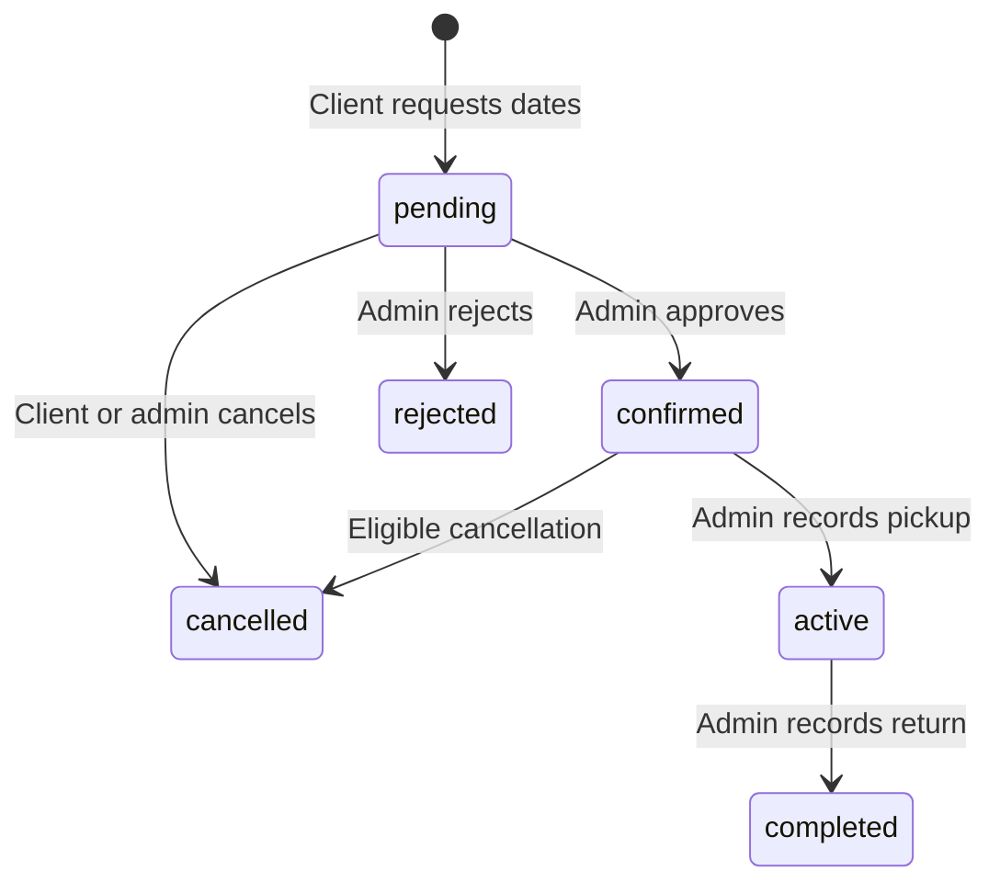

# Multi-user implementation plan

Status: Supabase selected; account/catalog schema and permissions prepared locally.
Hosted setup and app activation are pending; the tested local application remains
the working baseline. See [Supabase setup](supabase-setup.md).

The user confirmed that clients will book motors and admins will manage inventory,
and that bookings must receive admin approval first. Supabase was selected subsequently. Remaining operational defaults below are
proposals for implementation.

## First release

One rental business, with a shared catalog used by clients and admins across devices.
For this release, each motor listing represents one physical rentable motorcycle.
Multiple shops and multiple units under one listing can be designed later.

Clients register, sign in, browse active motors, request rental dates, view their own
bookings, and cancel eligible bookings. Admins manage motors, approve or reject
requests, record pickup and return, and view all bookings. Email password recovery
is part of shared authentication. Initial payment method: pay on pickup; online
payments, reviews, and push notifications come later.

## Permissions

| Action | Guest | Client | Admin |
| --- | --- | --- | --- |
| Register, log in, request password recovery | Yes | Yes | Yes |
| Browse catalog and motor details | Login first | Yes | Yes |
| Read/update personal profile | No | Own profile | Own profile |
| Request a booking | No | For self | Separate admin booking flow later |
| Read bookings | No | Own bookings | All bookings |
| Cancel before rental starts | No | Own pending/confirmed bookings | Pending/confirmed bookings, with reason |
| Create/edit/archive motors; set maintenance status | No | No | Yes |
| Approve/reject a pending request | No | No | Yes |
| Record pickup and return | No | No | Yes |
| Change account roles | No | No | Trusted operator outside the mobile app |

Registration always creates a client. There is no role selector or hidden email-based
admin bypass. The first admin is assigned through a trusted backend operation after
its account exists. Further role assignment uses the same controlled process.

Enforce these rules at the backend as well as in navigation. A client must not be
able to promote itself, alter another user's booking, set booking prices, or directly
change statuses by sending a modified API request. Profile updates cannot change roles.

## Shared data model

| Entity | Main fields and rules |
| --- | --- |
| Auth users | Managed identity, verified email, password credentials, recovery and sessions. App tables do not store passwords. |
| Profiles | `id` references auth user UUID; `full_name`, optional `phone`, timestamps. Client may edit own permitted fields. |
| User roles | `user_id`, `role` (`client` or `admin`). Backend-controlled writes only. |
| Motors | UUID `id`, `name`, `type`, `description`, `daily_rate_centavos`, `image_path`, `operating_status` (`available` or `maintenance`), nullable `archived_at`, timestamps. |
| Bookings | UUID `id`, `client_id`, `motor_id`, `start_date`, `end_date`, `status`, `daily_rate_centavos`, `total_centavos`, `currency` (`PHP`), `payment_method` (`pay_on_pickup`), request id, timestamps. |
| Booking events | `id`, `booking_id`, actor user UUID, old/new status, optional reason, timestamp. Server-written history; clients can read events belonging to their bookings. |

Use foreign keys and retain archived motors and booking history. Store money as
integer centavos and save the agreed price in each booking; later catalog price
changes must not rewrite existing booking totals. UUIDs replace device-local IDs.
Images move to shared storage with admin upload permissions and catalog read access.

## Booking lifecycle

Pending requests do not reserve a motor. The UI must say “Awaiting admin approval”
and explain that availability is confirmed upon approval. This allows overlapping
requests without falsely promising multiple clients the same unit.

The backend checks the motor and dates on request and checks them again atomically
on approval. Only one overlapping request can become confirmed. A conflicting
request stays pending until the admin chooses another action. Admin decisions and
cancellation reasons are recorded in booking events.

Proposed date rules: date-only rentals in Asia/Manila, start inclusive and end
exclusive, minimum one day, and no past start dates. For example, November 20–22 is
two rental days; another rental may start on November 22. Confirm pickup/return
hours with the team before building the date UI.

Proposed cancellation rule: clients can cancel their own pending requests and
confirmed rentals before the start date. Once active, changes require an admin.
Reject invalid transitions even when called directly through the API.

At pickup, the backend must also confirm that the physical motor has no other active
rental, including an overdue rental whose originally booked end date has passed.
Archiving or scheduling maintenance must not silently cancel an existing booking.
An admin must resolve affected confirmed/active rentals before blocking the unit.

## Backend recommendation

Recommend **Supabase Auth + PostgreSQL + Storage**, using database functions for
booking operations and row-level security for account and data access. Supabase
provides a React Native authentication guide, password recovery, and PostgreSQL
row-level security. This combination fits the relational booking model and avoids
application-managed password hashing during startup.

| Option | Fit for this project | Main tradeoff |
| --- | --- | --- |
| Supabase | Managed auth plus PostgreSQL permissions and relational booking data | Requires careful policies, transactional functions, and email configuration |
| Firebase | Managed auth with document or relational database options | Needs a different data/access design or its SQL Connect workflow |
| Custom API + PostgreSQL | Full control over authentication and booking logic | Team owns API hosting, email integration, auth/session maintenance, and deployment |

This is a design recommendation, not a provisioned service. Select the provider
before installing its client or changing authentication. No paid plan is assumed.

For Supabase, use database policies for reading permitted rows and narrowly scoped
functions for requesting, approving, cancelling, picking up, and completing a booking.
Clients cannot directly update protected booking columns. Functions derive the actor
from the authenticated session, validate roles, and calculate totals on the server.
If privileged functions are needed, restrict their execute permissions and search path.

Use a database exclusion constraint on the motor and reserved date range for
confirmed/active bookings, plus transactional validation. A frontend availability
check alone cannot prevent two simultaneous approvals. Use a client-generated
request UUID with a uniqueness rule per user so retries cannot duplicate a booking.

Email recovery needs allowed redirect URLs, a reset screen, and configured email
delivery. Test expired links, reused links, and unavailable email delivery. Keep
service-role keys, database credentials, and email credentials on the server.
The app may contain only the provider's intended public/publishable configuration.

## Implementation order and acceptance checks

1. **Backend project and schema.** Select provider, create a development environment,
   write migrations and access policies, and assign the first admin. Verify that
   direct client requests cannot write motor records, roles, or other users' data.
2. **Shared authentication and profiles.** Replace local account/session functions
   behind the existing AuthContext interface. Test registration, email confirmation,
   login, logout, restart, and revoked/expired sessions on two accounts and devices.
   Include loading/error states and an explicit configuration error when setup is
   missing; do not silently fall back to local authentication.
3. **Password recovery.** Configure email delivery and app/web redirects. Test the
   entire email-to-new-password flow on an actual iPhone and through a browser.
   Remove the recovery availability notice only after this works.
4. **Shared catalog and admin UI.** Replace local motor operations behind the existing
   inventory context, add admin route guards, and verify that admin changes appear
   on another device. Backend permissions remain authoritative.
5. **Client booking requests.** Add dates, server-calculated price summary, pending
   confirmation, booking history, cancellation, and network-retry handling.
6. **Admin booking management.** Add approve/reject, pickup/return, reasons, and
   overview counts. Test simultaneous approval attempts, overdue rentals, maintenance,
   archive restrictions, invalid transitions, and historical price preservation.

A startup smoke test on the iPhone is required at each integration step. Keep heavy
migration work and password derivation out of the app's startup path. Apply backend
schema migrations separately from normal client startup.

## Existing local data

Preserve the working local database while developing the cloud branch. For the first
pilot, propose registering new shared accounts rather than automatically uploading
local passwords. Local user IDs and sessions are not valid cloud identities.
Confirm that account transition with the team before switching the app.

Import selected local motors once through an admin-controlled process with a
local-to-cloud ID mapping; do not let each device seed the shared catalog. Review
image rights and replace sample image URLs as needed. Keep a backup until the shared
version passes the device checklist. SQLite may later cache catalog data, but shared
availability and booking writes require the backend and an online confirmation.

## References

- [Supabase React Native authentication](https://supabase.com/docs/guides/auth/quickstarts/react-native)
- [Supabase row-level security](https://supabase.com/docs/guides/database/postgres/row-level-security)
- [Supabase password recovery](https://supabase.com/docs/guides/auth/passwords)
- [Supabase custom SMTP configuration](https://supabase.com/docs/guides/auth/auth-smtp)
- [PostgreSQL range types and exclusion constraints](https://www.postgresql.org/docs/current/rangetypes.html)
- [Firebase SQL Connect overview](https://firebase.google.com/docs/sql-connect)
